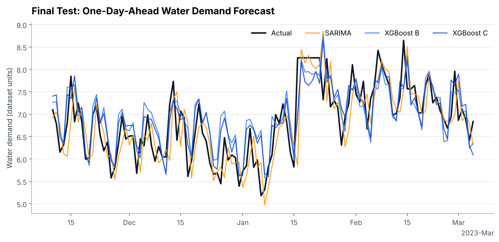
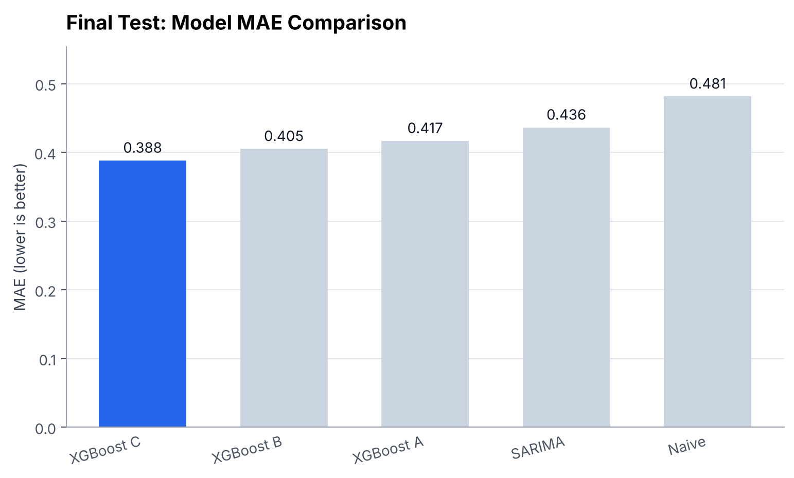

# Urban Water Demand Forecasting

One-day-ahead forecasting of daily water demand for a single district metered area (DMA A), comparing a **naive baseline**, **SARIMA**, and **XGBoost** with progressively richer features.



## Results

Held-out test set: 116 days (10 Nov 2022 – 5 Mar 2023). Models are refit on train + validation. Lower is better.

| Model | Features | MAE | RMSE | sMAPE |
|---|---|---|---|---|
| **XGBoost C** | history + calendar + weather | **0.388** | **0.496** | **5.64%** |
| XGBoost B | history + calendar | 0.405 | 0.525 | 5.92% |
| XGBoost A | history only | 0.417 | 0.549 | 6.02% |
| SARIMA (1,0,0)(1,0,0,7) | – | 0.436 | 0.565 | 6.45% |
| Naive (yesterday) | – | 0.481 | 0.620 | 7.09% |

XGBoost C cuts MAE by **19%** versus the naive baseline and **11%** versus SARIMA.



## Things to know when reading the results

- **The test period is winter only** and has no high-demand days, so peak-demand accuracy is evaluated on the validation set (24 peak days, Jul–Nov 2022). There, XGBoost B/C, SARIMA and naive are essentially tied (peak MAE ≈ 0.87); history-only XGBoost is clearly worse (1.12).
- **On validation, SARIMA was slightly better overall** (MAE 0.656 vs 0.671 for XGBoost C). XGBoost's edge shows on the test set, so treat the gap as modest.
- **Weather adds a small gain** (B → C: −0.017 MAE on test, −0.002 on validation). Calendar features gave the larger gain on validation (A → B: −0.066); on test the two steps are similar (−0.012 and −0.017).
- **Imputed values:** the `v-0_nans` column counts missing readings per day. 21 of the 232 validation/test days carry the same constant fill value (8.26) – visible as flat stretches in the plots.
- Forecasts are strictly **one day ahead**, using yesterday's observed demand. Demand units are those of the source dataset.

## Method

1. **Preprocessing** – continuity checks, lag features (1, 2, 3, 7, 14 days), shifted rolling mean/std (3, 7, 14 days), calendar features, weather features; chronological 70 / 15 / 15 split.
2. **Baselines** – naive and SARIMA (four candidates, chosen on validation MAE).
3. **XGBoost feature ablation** – A: history → B: + calendar → C: + weather.
4. **Peak analysis** – "high demand" = above the training 90th percentile (11.09).
5. **Final test** – refit on train + validation, evaluate once on the test set.

## Run it

```bash
pip install -r requirements.txt
python run_all.py          # or run any script in src/ on its own, in order
```

## Structure

```
data/         raw CSV and processed train / validation / test splits
src/          one script per step; utils.py holds shared features, metrics and plot style
results/      figures and CSV tables, one folder per step
run_all.py    runs the whole pipeline
```
